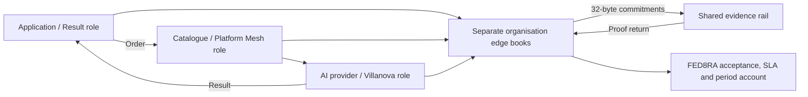

# FED8RA Lab

**Follow the work. Verify the delivery. Share the account.**

A partner-facing record of experiments connecting applications, AI providers and platform services through the existing NEO edge, shared evidence rail and federation accounting.

Our next experiment follows one service lifecycle: **publish → subscribe → order → execute → deliver → accept → account → independently verify**.

**Current status: PREPARING — the 48-hour experiment has not started.** This repository presents a proposed integration and will retain measured results, including failures. It does not announce a production service or partner endorsement.

## Start here

| Read | Purpose |
|---|---|
| [48-hour experiment](docs/EXPERIMENT.md) | Scenario, workload, failures and completion criteria |
| [Partner roles](docs/PARTNER-ROLES.md) | Result, Villanova, SAP and FED8RA: proposed roles and actual execution boundaries |
| [How to participate](docs/CONNECT.md) | Application events, server edges and the installation review |
| [Evidence and accounting](docs/EVIDENCE.md) | What a proof establishes, what stays local and how results are reported |
| [Current run](runs/2026-10-27-villanova-48h/README.md) | Preparation status; start and end remain unset |

Original documents and results remain in their owner's storage. The rail records commitments. Independent verification uses retained originals, local records and the existing proof-return path; hashes cannot reconstruct lost documents.

## What is already available

The existing stack supplies the server-edge package, business action tracking, evidence return, accounting components and Chamber process. Component tests and earlier experiments exist separately. Their results do not automatically qualify this new combined run.

For this experiment, CPU-only scheduling and unprivileged network isolation were checked on Villanova infrastructure. The selected server-edge source package was installed in an isolated user directory, its source checks passed, strict cryptographic support was available, and seven packaging tests passed after supplying test dependencies and public-key fixtures. **No live edge or first FINAL has yet been established for this experiment.** These are preparation checks, not the result of the 48-hour run.

## Relationship to existing work

This is a documentation and publication repository, not a replacement for the operational FED8RA programme or a fork of the edge, accounting engine or Chamber. Operational code and unrestricted evidence stay in their existing controlled repositories. Only reviewed, shareable material is copied here.

- [Ambiti8n proposal](https://cotrugli.tech/demo/ambiti8n-5/)
- [Current Chamber rules](https://cotrugli.tech/demo/chamber-rules/)

Named organisations describe intended collaboration roles. LAB identities are operated by us unless a report explicitly identifies a partner-operated installation. Access to partner compute is not partner acceptance of the complete workflow.
